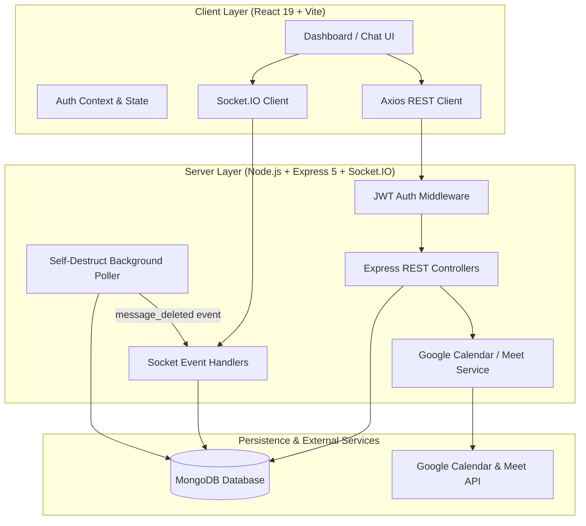

# NOVA — Real-Time Chat Application

**Tagline:** *Connect. Chat. Collaborate.*  
**Context:** AVIP 2026 Full Stack Development Internship Project  
**Author:** Krithika D V  

---

## 1. Project Overview

**NOVA** is a modern, full-stack, enterprise-grade real-time messaging application engineered to support high-concurrency communications, database-level account isolation, ephemeral self-destructing messages, group collaboration, and integrated video meeting coordination featuring genuine **Google Meet** integration.

NOVA demonstrates real full-stack engineering across the stack:
- **Instant Messaging**: Real-time bi-directional messaging with Socket.IO and MongoDB persistence.
- **Data Isolation**: Strict user-level and conversation-level authorization enforced server-side.
- **Group Chat**: Dynamic group creation, member management, and authorized group rooms.
- **Google Meet Integration**: Official Google Calendar & Meet API conference generation paired with server-side URL validation.
- **Ephemeral Privacy**: Automated 15-second self-destruct message lifecycle triggered strictly upon recipient view.
- **Dark Space Aesthetic**: Professional, high-contrast, space-inspired interface with glassmorphism and responsive design.

---

## 2. Technology Stack

### Frontend
- **Framework**: React 19 + TypeScript + Vite 8
- **Routing**: React Router 7 (Single Page Application architecture)
- **State & Context**: React Context API (`AuthContext`)
- **HTTP Client**: Axios with automated Bearer token authorization interceptors
- **Real-Time Client**: Socket.IO Client 4.8.3 with authenticated handshake
- **Styling**: Vanilla CSS design system with CSS custom properties, glassmorphism, and responsive breakpoints
- **OAuth**: `@react-oauth/google`

### Backend
- **Runtime**: Node.js + Express 5 (TypeScript via `tsx`)
- **Real-Time Engine**: Socket.IO 4.8.3 with custom authorization middleware
- **Security & Cryptography**: JWT (`jsonwebtoken`), `bcrypt` (10 salt rounds)
- **Database Engine**: MongoDB with Mongoose 9.10.1 ORM
  - *Zero-Config Fallback*: Automatically uses `mongodb-memory-server` if local MongoDB daemon is not detected.
- **Google Workspace API**: Official `googleapis` (v3 Google Calendar API & Meet conference creation)
- **File Management**: Multer disk storage (with 10MB limits and MIME type filtering)
- **Email Service**: Nodemailer (supporting Ethereal test accounts and custom SMTP)

---

## 3. System Architecture



---

## 4. Database Schema Design

### 1. `User` Schema
```ts
{
  username: { type: String, required: true, unique: true },
  name: { type: String },
  email: { type: String, required: true, unique: true, lowercase: true },
  passwordHash: { type: String, required: true },
  profilePicture: { type: String, default: '' },
  status: { type: String, default: 'Available' },
  profileSetupComplete: { type: Boolean, default: false },
  googleId: { type: String, sparse: true },
  googleCalendarTokens: {
    access_token: String,
    refresh_token: String,
    expiry_date: Number
  },
  resetPasswordToken: String,
  resetPasswordExpires: Date
}
```

### 2. `Conversation` Schema
Supports both direct 1-to-1 conversations and multi-member groups:
```ts
{
  type: { type: String, enum: ['direct', 'group'], default: 'direct' },
  name: { type: String, trim: true },
  description: { type: String, trim: true },
  admin: { type: Schema.Types.ObjectId, ref: 'User' },
  participants: [{ type: Schema.Types.ObjectId, ref: 'User', required: true }]
}
```

### 3. `Message` Schema
```ts
{
  senderId: { type: Schema.Types.ObjectId, ref: 'User', required: true },
  roomId: { type: String, required: true },
  content: { type: String, required: true },
  messageType: { type: String, enum: ['text', 'meeting', 'file'], default: 'text' },
  meetingId: { type: Schema.Types.ObjectId, ref: 'Meeting', default: null },
  status: { type: String, enum: ['sent', 'read'], default: 'sent' },
  readAt: { type: Date, default: null },
  scheduledDeletionAt: { type: Date, default: null },
  attachmentUrl: { type: String },
  attachmentType: { type: String },
  attachmentName: { type: String }
}
```

### 4. `Meeting` Schema
```ts
{
  title: { type: String, required: true },
  description: { type: String },
  startTime: { type: Date, required: true },
  endTime: { type: Date },
  createdBy: { type: Schema.Types.ObjectId, ref: 'User', required: true },
  participants: [{ type: Schema.Types.ObjectId, ref: 'User' }],
  conversationId: { type: Schema.Types.ObjectId, ref: 'Conversation' },
  googleMeetUrl: { type: String, trim: true },
  googleEventId: { type: String, trim: true },
  isManualLink: { type: Boolean, default: false },
  status: { type: String, enum: ['scheduled', 'completed', 'cancelled'], default: 'scheduled' }
}
```

---

## 5. Security & Privacy Architecture

### Account Data Isolation
1. **Database Query Filtering**:
   - `GET /api/chat/conversations` filters strictly by `{ participants: req.userId }`.
   - `GET /api/meetings` filters strictly by `{ $or: [{ createdBy: req.userId }, { participants: req.userId }] }`.
   - `GET /api/chat/messages?roomId=...` explicitly validates conversation participant membership before returning records.
2. **Socket Room Authorization**:
   - Every socket connection performs an initial handshake requiring a verified JWT.
   - Sockets joining a room (`join_room`) are verified against the conversation or meeting participant list. Unauthorized attempts receive an error event and are denied entry.
3. **Password Protection**:
   - Password hashes are excluded from all user query responses via `.select('-passwordHash ...')`.
4. **Stale State Prevention**:
   - On account logout or switch, client tokens are cleared from storage, socket connections are disconnected, and React state (`conversations`, `meetings`, `activeRoom`) is reset.

---

## 6. The 15-Second Self-Destruct Lifecycle

NOVA implements an automated read-receipt-triggered ephemeral message lifecycle:

1. **Sent**: User A sends a message. The message is stored in MongoDB with `status: 'sent'`.
2. **Viewed by Recipient**: When User B opens the chat and the message enters viewport, frontend `IntersectionObserver` emits `mark_read`.
3. **Sender-Protection Verification**: The backend validates that `socket.userId !== message.senderId` (the sender viewing their own message does not trigger self-destruction).
4. **Scheduling**: The backend marks the message `status: 'read'` and sets `scheduledDeletionAt = readAt + 15s`. It broadcasts `message_status_update`.
5. **Visual Countdown**: User A and User B see an active 15-second countdown timer badge in the message bubble.
6. **Background Sweeper**: A background service (`cleanup.service.ts`) queries MongoDB every 2 seconds for messages where `scheduledDeletionAt <= now`.
7. **Deletion & Broadcast**: Expired messages are deleted from MongoDB and a `message_deleted` event is broadcast to the room, instantly removing the message from all client views.

---

## 7. Google Meet Integration

NOVA supports genuine Google Meet video conferences via a dual-mode engine:

### Mode 1: Automated Google Calendar & Meet Conference Generation
- Organizers link their Google account via the OAuth 2.0 flow (`/api/meetings/google/auth-url`).
- When scheduling a meeting, the backend calls Google Calendar API v3 with:
  ```json
  {
    "conferenceData": {
      "createRequest": {
        "requestId": "nova-unique-id",
        "conferenceSolutionKey": { "type": "hangoutsMeet" }
      }
    }
  }
  ```
- Google creates the calendar event and returns a real Google Meet URL (`https://meet.google.com/xxx-xxxx-xxx`).
- The link is stored in MongoDB and rendered in NOVA as an official Google Meet badge with a one-click "Join Google Meet" action.

### Mode 2: Server-Side Validated Manual Google Meet Links
- If an organizer has an existing Google Meet link, they can provide it directly.
- The backend strictly validates the format:
  `^https:\/\/meet\.google\.com\/[a-z]{3}-[a-z]{4}-[a-z]{3}(\?.*)?$`
- Arbitrary URLs or phishing links are rejected with HTTP 400 Bad Request.
- Links are clearly labelled in the UI as direct manual links.

### In-Chat Meeting Cards
When a meeting is scheduled inside a direct or group conversation, NOVA automatically posts an interactive Meeting Card into the chat history displaying title, time, host, participants, and a one-click "Join Google Meet" button.

---

## 8. Installation & Execution Guide

### Prerequisites
- Node.js (v18 or higher)
- npm (v9 or higher)

### 1. Backend Setup
```bash
cd backend
npm install
npm run dev
```
*The backend starts at `http://localhost:5005`. It will automatically use an in-memory MongoDB instance if local MongoDB is not running.*

### 2. Frontend Setup
In a second terminal:
```bash
cd frontend
npm install
npm run dev
```
*The frontend starts at `http://localhost:5173`.*

---

## 9. Environment Variables

### Backend Configuration (`backend/.env`)
```ini
PORT=5005
MONGODB_URI=mongodb://localhost:27017/realtime_chat
JWT_SECRET=your_super_secret_jwt_key
CLIENT_URL=http://localhost:5173

# Google Workspace / Calendar API Credentials
GOOGLE_CLIENT_ID=your_google_client_id.apps.googleusercontent.com
GOOGLE_CLIENT_SECRET=your_google_client_secret
GOOGLE_REDIRECT_URI=http://localhost:5173/dashboard

# Optional SMTP Configuration
SMTP_HOST=
SMTP_PORT=587
SMTP_USER=
SMTP_PASS=
EMAIL_FROM="NOVA Security" <security@nova.chat>
```

### Frontend Configuration (`frontend/.env`)
```ini
VITE_API_URL=http://localhost:5005/api
VITE_SOCKET_URL=http://localhost:5005
VITE_GOOGLE_CLIENT_ID=your_google_client_id.apps.googleusercontent.com
```

---

## 10. Automated End-to-End Verification Suite

NOVA includes an automated multi-account verification test suite:

```bash
cd backend
npx tsx test_suite_e2e.ts
```

### Test Coverage (11/11 Verified):
1. **Independent Account Registration**: Creates Account A (Krithika), Account B (Rahul), and Account C (Eve).
2. **Session Authentication**: Independent JWT token issuance and user profile isolation.
3. **User Discovery**: User A discovers User B without exposing password hashes.
4. **Direct Conversation Creation**: Establishes 1-on-1 private conversation.
5. **Account Data Isolation**: Unauthorized User C is blocked (HTTP 403) from reading private conversation.
6. **Real-Time Socket Delivery & Isolation**: Real-time delivery to User B; User C socket receives zero data leaks.
7. **15-Second Self-Destruct Lifecycle**: Read-receipt countdown initiates only on recipient view.
8. **Group Chat & Membership**: Core group creation, messaging, and access rejection for non-member User C.
9. **Meeting Scheduling & Link Validation**: Rejection of invalid meeting links; acceptance of valid Google Meet conferences.
10. **Meeting Data Isolation**: User C cannot view or cancel User A/B meetings.
11. **In-Chat Meeting Cards**: Verification of meeting cards inside conversation history.

---

## 11. Internship Demonstration Sequence

To present NOVA during your internship evaluation, follow this sequence:

1. **Independent Account Creation**:
   - Register **Account A** (`krithika@example.com`) and log in.
   - In an incognito window, register **Account B** (`rahul@example.com`) and log in.
2. **User Discovery & 1-on-1 Chat**:
   - As Account A, click **Find** or **⊕ New** under Direct Messages, search for `rahul`, and start a conversation.
   - Send a message: `"Hello Rahul, welcome to NOVA!"`
   - Observe instant real-time delivery in Account B's browser.
3. **15-Second Self-Destruct Demonstration**:
   - Notice that Account A seeing the sent message does not start the countdown.
   - When Account B views the message in their viewport, the countdown triggers: *"Disappears in 15s"*.
   - Watch the timer count down to 0, after which the message deletes from MongoDB and disappears from both screens.
4. **Group Conversation**:
   - In Account A, switch to the **Groups** tab and click **⊕ Create Group**.
   - Enter name `"NOVA Engineering"`, select `rahul`, and create the group.
   - Exchange messages in the group room and inspect the group member panel.
5. **Meeting Scheduling & Genuine Google Meet**:
   - In the conversation header, click **📅 Schedule Meeting**.
   - Enter title `"Sprint Planning"`, select tomorrow's date, and enter Google Meet link `https://meet.google.com/abc-defg-hij`.
   - Click **Schedule & Invite**.
   - Notice the rich **Meeting Card** appear inside the conversation with a blue **"📹 Join Google Meet"** button.
   - Click the button to demonstrate opening Google Meet in the browser.
6. **Data Isolation & Account Switching**:
   - Register a 3rd account in another tab.
   - Show that the 3rd account sees 0 private messages, 0 group chats, and 0 scheduled meetings from Accounts A and B.
   - Log out of Account A and observe all private state reset cleanly.

Live demo: https://fsd-4-real-time-chat-application-by-plum.vercel.app
linkedin : https://www.linkedin.com/in/krithika-d-v-79b558335?utm_source=share_via&utm_content=profile&utm_medium=member_android
